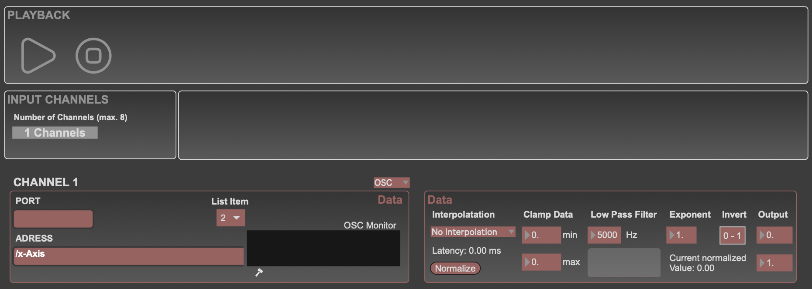

# Advanced Sonification Toolkit V_1

*Max 9.0.5*

Max Project for the first Version of the **Advanced Sonification Toolkit**.

The toolkit enables movement-based sonification of recorded sensor data through the following core features:

 

## Functionality Summary
- **Input**:
  - Input data as a 2-channel `.wav` file:
    - **Channel 1**: Timestamps
    - **Channel 2**: Signal values

- **Dynamic Playback Engine**:
  - Respects native time resolution of recorded sensor data by dynamic **sampling rate adaptation**.
  - Supports **variable playback speed**.

- **Multi-Channel Support**:
  - Multiple channels can be loaded and played back simultaneously.

- **Normalization and Filtering**:
  - Minimum/Maximum values to implement the critical range for sonification.

- **Graphical Interface**:
  - Control over waveform selection, playback, and data shaping.

## User Interface Overview

The UI of the Sonification Toolkit in Max/MSP is designed to access playback control, waveform navigation, channel management and data manipulation7filtering. It is modular and supports flexible integration of different sensor channels.

###  Playback Section
- **Play / Pause / Stop buttons** for controlling the playback of data.
- **Playback Speed**: Adjustable from 1–1000% .
- **Data Metrics**:
  - Number of datapoints.
  - Total duration (in seconds).

### Input Channels
- **Channel Selector**: 
  - Indicates the number of available channels.

### Waveform Navigation
- **Navigation Controls**:
  - Zooming and selection functionality for precise waveform inspection.

- **Time Selection Panel**:
  - Displays selection start, end, and duration.

### Channel View
Each input channel includes:

#### File Loader
- Drag-and-drop or file picker to load a `.wav` file.
- Displays file path and metadata.

#### File Info
- Minimum, maximum, and average value of the loaded signal data.

#### Waveform Display
- Interactive waveform with indication of selected range.
- Responds to zoom and navigation inputs.
- Cursor displaying the playback position.

### Data Processing Controls
- **Interpolation Options**:
  - Shows latency estimate.
- **Clamp Data**:
  - Minimum and maximum values to constrain the signal range.
- **Low Pass Filter**:
  - Adjustable cutoff frequency.
- **Exponent Shaping**:
  - Adjust non-linear response curves.
  - Real-time feedback of current normalized value.

### Sound Design Modules

- **Choose Module**:
  - Dropdown menu to choose one of the modules that are part of the project.

- **Manual Controls**:
  - Manual control of sound parameters.

- **Mapping Matrix**:
  - Mapping of input data to sound parameter.
  - When input data is mapped to a parameter, manual control is deactivated.

## Sound Design Modules

The toolkit currently includes **4 sound design modules**:

1. **Test**  
   - Simple sine tone  
   - **Parameters**: `Pitch`, `Volume`

2. **Abstract**  
   - Additive synthesizer  
   - **Parameters**:  
     - `Pitch`  
     - `Harmonicity` (relationship of overtones: 0 = harmonic", 1 = disharmonic)  
     - `Timbre` (Number and volume of overtones)

3. **Musical**  
   - Plays segments of well-known melodies (e.g., *Für Elise*, *Bach Prelude in C*) on a synthesized string instrument  
   - **Parameters**:  
     - `Tempo`  
     - `Volume`  
     - `Tuning` (0 = in tune, 1 = each note is up to one semitone off)  
     - `Note Length`

4. **Ambient**  
   - Synthesized natural soundscape  
   - **Parameters**:  
     - `Birds`  
     - `Wind`  
     - `Rain`  
     - `Thunder`

A template ('AST_V1_Sounddesign_Module_Template.maxpat') is included to allow users to create and integrate custom **sound design modules**.
In the template, the Max project automatically recognizes new modules and adds them to the toolkit interface:

1. **Patcher Naming**  
   - Use the format: `"AST_V1_SM_*.maxpat"` so the toolkit identifies it as a sound design module.

2. **Sound Engine Setup**  
   - Build a custom sound engine and connect it to the incoming parameter signals.  
   - All signals from the data playback range from 0 to 1.

3. **UI Integration**  
   - Place all parameter knobs/sliders inside the `"Manual Controls"` section in **Presentation Mode** for UI consistency.

 
