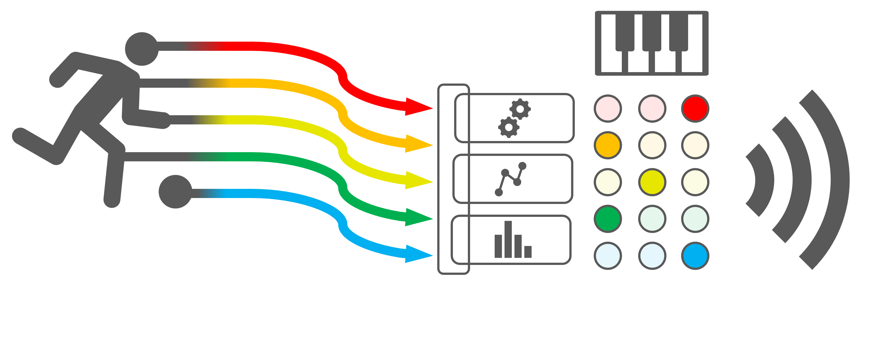

# Advanced Sonification Toolkit V_2

Max Project for the **Advanced Sonification Toolkit**.

## Table of Contents

- [Introduction](#introduction)
- [Requirements](#requirements)
- [License](#license)
- [Funding & Research Context](#funding--research-context)
- [Functionality Summary](#functionality-summary)
- [User Interface Overview](#user-interface-overview)
- [Sound Design Modules](#sound-design-modules)
- [Detection Modules](#detection-modules)

## Introduction

The Advanced Sonification Toolkit (AST_v2) is a modular, UI-driven system for creating and exploring movement-based sonification. It is designed to support real-time, embodied use in contexts such as sports, rehabilitation, and interactive performance.

The toolkit addresses a common limitation in sonification practice: systems are often built as custom, case-specific implementations, making them difficult to reuse, compare, or adapt—especially for non–sound experts. AST_v2 provides a flexible environment that allows users to configure, test, and iterate on sonification strategies without low-level audio programming.

It supports both recorded datasets and live sensor input (via Serial or OSC), which are processed through a shared architecture for data shaping, feature extraction, mapping, and sound generation. A matrix-based routing system enables the assignment of raw or derived data streams to sound parameters across multiple sound design modules.

The toolkit follows a modular architecture, separating input handling, processing, detection, mapping, and sound synthesis. 
This allows users to reconfigure sonification setups and extend the system with custom modules without modifying the core structure.
AST_v2 is intended both as a practical tool for building movement sonification systems and as a platform for exploring and comparing different sonification approaches.

**The toolkit enables movement-based sonification of sensor data through two input modes:**

- **Recorded Data Mode**: for playback and analysis of pre-recorded datasets  
- **Real-Time Input Mode**: for live sonification of incoming sensor streams  

 

**Author & Contact**

Michael Reichmann

*`michael.reichmann@plus.ac.at`*

University of Salzburg

## Requirements

This project requires a valid **Max** license to run.  
Max is a proprietary programming environment developed by Cycling ’74 and is required to run this project.

A free trial version of Max is available for 30 days:

[Cycling '74 Website](https://cycling74.com/downloads)  

After the trial period, Max continues to run but does not allow saving or modifying patches. 
The toolkit itself remains fully functional in this restricted mode. 
A full license is only required if you want to modify the project or develop custom modules.

Max Version: *Max 9.1.2*

## License

This project is licensed under the PolyForm Noncommercial License 1.0.0.  
Free to use, modify, and share for non-commercial purposes.  
Commercial use requires a separate agreement.  

[PolyForm Noncommercial Licence Website](https://polyformproject.org/licenses/noncommercial/1.0.0/)

See the LICENSE file for details.

The license applies only to the toolkit code provided in this repository.  
Max itself requires a separate license.  
Third-party components and referenced projects (e.g., step detection or breathing detection algorithms) are subject to their own respective licenses.

## Funding & Research Context

This project was developed within the **Digital Motion (DiMo / DiMo-NEXT)** research initiative, a transdisciplinary program exploring the use of sensor data and movement analysis in areas such as sports, health, and human-centered design.
Conducted as a collaboration between academic and industry partners.

[DiMo-NEXT Website](https://www.digital-motion.at)

 

## Functionality Summary

- **Input Modes**:

  **Recorded Data Mode**:
  - Input data as a 2-channel `.wav` file:
    - **Channel 1**: Timestamps  
    - **Channel 2**: Signal values  
  - Dynamic playback engine with variable speed  
  - Waveform navigation and time selection  

  **Real-Time Input Mode**:
  - Real-time data input via:
    - **Serial Communication**
    - **OSC (Open Sound Control) over WiFi**
  - Flexible data parsing using address filtering and list item selection  

- **Multi-Channel Support**:
  - Multiple channels can be configured and processed simultaneously  
  - Each channel represents a single data stream  

- **Normalization and Filtering**:
  - Minimum/Maximum values to implement the critical range for sonification  

- **Graphical Interface**:
  - Control over input configuration, playback, data monitoring, and data shaping  

- **Modular Processing Architecture**:
  - Supports both **raw data streams** and **derived feature streams** through detection modules  
  - Flexible routing allows combining raw sensor data and detected events for sound control  

 

 

## User Interface Overview

The toolkit starts with a **home screen** where one of the two input modes can be selected:

- **Recorded Data Mode**
- **Real-Time Input Mode**

Both modes share the same processing, mapping, and sound design architecture.

### Recorded Data Mode

The UI provides playback control, waveform navigation, and data inspection.

#### Playback Section
- **Play / Pause / Stop buttons** for controlling playback  
- **Playback Speed**: Adjustable from 1 – 1000%  
- **Data Metrics**:
  - Number of datapoints  
  - Total duration (in seconds)  

#### Channel View
Each input channel includes:

- File loader for `.wav` input  
- File information (min, max, average values)  
- Interactive waveform display with zoom and selection  
- Playback position cursor  

### Real-Time Input Mode

The UI provides configuration and monitoring of incoming data streams.

#### Input Configuration
- **Input Type Selection**:
  - Choose between **Serial** and **OSC** per channel  

- **Serial Input**:
  - Select available serial port  
  - Set baud rate  

- **OSC Input**:
  - Define OSC address for incoming data  

- **Address Filtering**:
  - Filter incoming messages using a string identifier (e.g., `X:` or `xyz:`)  

- **List Item Selection**:
  - Extract specific values from grouped data streams  
  - Example:
    - Input: `xyz: 0.0012 0.134 1.233`  
    - Address: `xyz:`  
    - List Item:
      - `1` → X  
      - `2` → Y  
      - `3` → Z  

- **Data Monitor**:
  - Displays incoming data in real time  

### Input Channels
- **Channel Selector**:
  - Indicates the number of available channels  
  - Each channel processes one data stream  
  - Multiple channels are required for multi-dimensional data (e.g., X, Y, Z)  

### Data Processing Controls
- **Clamp Data**:
  - Minimum and maximum values to constrain the signal range  
- **Low Pass Filter**:
  - Adjustable cutoff frequency  
- **Exponent Shaping**:
  - Adjust non-linear response curves  
  - Real-time feedback of current normalized value  

### Processing and Routing
- **Raw Data Routing**:
  - Direct mapping of processed input channels to sound parameters  

- **Detection Modules**:
  - Extract higher-level features (e.g., events, magnitude) from input data  
  - Outputs are available alongside raw signals  

- **Mapping Matrix**:
  - *Part of the Sound Desing Modules*
  - Assigns both raw data and detection outputs to sound parameters  

### Sound Design Modules

- **Choose Module**:
  - Dropdown menu to choose one of the modules that are part of the project  

- **Manual Controls**:
  - Manual control of sound parameters  

- **Mapping Matrix**:
  - Mapping of input data to sound parameter  
  - When input data is mapped to a parameter, manual control is deactivated  

The toolkit currently includes **4 sound design modules**:

1. **Test**  
   - Simple sine tone  
   - **Parameters**: `Pitch`, `Volume`  

2. **Abstract**  
   - Additive synthesizer  
   - **Parameters**:
     - `Pitch`  
     - `Harmonicity`  
     - `Timbre`  

3. **Musical**  
   - Plays segments of well-known melodies  
   - **Parameters**:
     - `Tempo`  
     - `Volume`  
     - `Tuning`  
     - `Note Length`  

4. **Ambient**  
   - Synthesized natural soundscape  
   - **Parameters**:
     - `Birds`  
     - `Wind`  
     - `Rain`  
     - `Thunder`  

### Sound Design Module Template

A template (`AST_V2_Sounddesign_Module_Template.maxpat`) is included to create custom modules.

1. **Patcher Naming**  
   - `"AST_V2_SM_*.maxpat"`  

2. **Sound Engine Setup**  
   - Signals range from 0–1  

3. **UI Integration**  
   - Use Presentation Mode  

## Detection Modules

Detection modules extract features and events from input data and make them available as control signals.

The toolkit includes:

1. **Step Detection**
- Detects impulses from 3 input channels  

2. **Breathing Detection**
- Detects peaks and troughs from 1 channel  

3. **Magnitude**
- Computes normalized magnitude from 3 channels  

### Detection Module Template

A template (`AST_V2_Detection_Module_Template.maxpat`) is included to create custom modules.

1. **Patcher Naming**  
   - `"AST_V2_DM_*.maxpat"`  

2. **Detection Algorithm**  
   - Input signals range from 0–1  

3. **UI Integration**  
   - Use Presentation Mode  

 