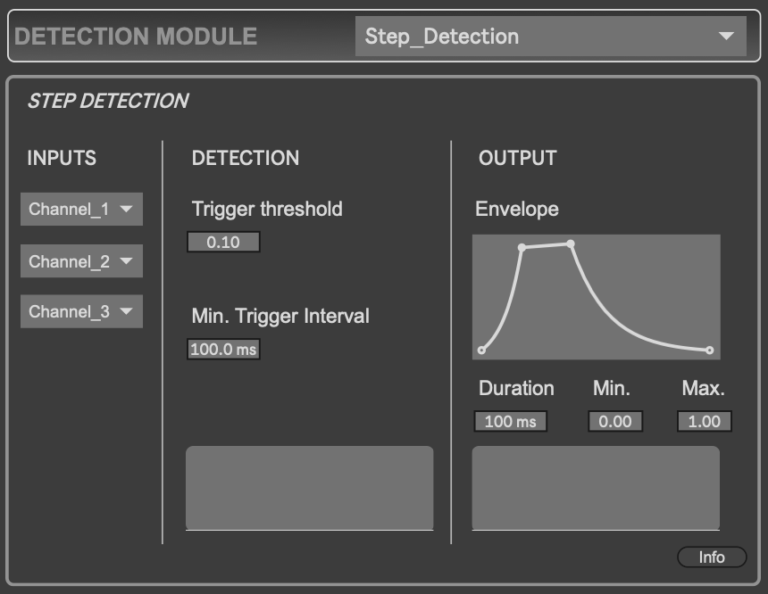

# Advanced Sonification Toolkit V_2

*Max 9.1.2*

Max Project for the **Advanced Sonification Toolkit**.

The toolkit enables movement-based sonification of real-time sensor data through the following core features:

 

## Functionality Summary
- **Input**:
  - Real-time data input via:
    - **Serial Communication**
    - **OSC (Open Sound Control) over WiFi**

- **Multi-Channel Support**:
  - Multiple channels can be configured and processed simultaneously.
  - Each channel represents a single data stream.

- **Flexible Data Parsing**:
  - Filtering of incoming data using address identifiers.
  - Extraction of specific values from data streams using list indexing.

- **Normalization and Filtering**:
  - Minimum/Maximum values to implement the critical range for sonification.

- **Graphical Interface**:
  - Control over input configuration, data monitoring, and data shaping.

- **Modular Processing Architecture**:
  - Supports both **raw data streams** and **derived feature streams** through detection modules.
  - Flexible routing allows combining raw sensor data and detected events for sound control.

## User Interface Overview

The UI of the Sonification Toolkit in Max/MSP is designed to access input configuration, channel management, and data manipulation/filtering. It is modular and supports flexible integration of different sensor channels and processing modules.

### Input Configuration
- **Input Type Selection**:
  - Choose between **Serial** and **OSC** per channel.

- **Serial Input**:
  - Select available serial port.
  - Set baud rate.

- **OSC Input**:
  - Define OSC address for incoming data.

- **Address Filtering**:
  - Filter incoming messages using a string identifier (e.g., `X:` or `xyz:`).

- **List Item Selection**:
  - Extract specific values from grouped data streams.
  - Example:
    - Input: `xyz: 0.0012 0.134 1.233`
    - Address: `xyz:`
    - List Item:
      - `1` → X  
      - `2` → Y  
      - `3` → Z  

- **Data Monitor**:
  - Displays incoming data in real time to assist with configuration and filtering.

### Input Channels
- **Channel Selector**: 
  - Indicates the number of available channels.
  - Each channel processes one data stream.
  - Multiple channels are required for multi-dimensional data (e.g., X, Y, Z).

### Channel View
Each input channel includes:

#### Input Settings
- Selection of input type (Serial / OSC).
- Configuration of port, baud rate, or OSC address.
- Address filter and list item selection.

#### Data Monitor
- Real-time display of incoming data.

#### Data Info
- Minimum, maximum, and current value of the incoming signal.

### Data Processing Controls
- **Clamp Data**:
  - Minimum and maximum values to constrain the signal range.
- **Low Pass Filter**:
  - Adjustable cutoff frequency.
- **Exponent Shaping**:
  - Adjust non-linear response curves.
  - Real-time feedback of current normalized value.

### Processing and Routing
- **Raw Data Routing**:
  - Direct mapping of processed input channels to sound parameters.

- **Detection Modules**:
  - Extract higher-level features (e.g., events, magnitude) from input data.
  - Outputs are available alongside raw signals.

- **Mapping Matrix**:
  - Assigns both raw data and detection outputs to sound parameters.
  - When input data is mapped to a parameter, manual control is deactivated.

### Sound Design Modules

- **Choose Module**:
  - Dropdown menu to choose one of the modules that are part of the project.

- **Manual Controls**:
  - Manual control of sound parameters.

- **Mapping Matrix**:
  - Mapping of input data to sound parameter.
  - When input data is mapped to a parameter, manual control is deactivated.

## Sound Design Modules

The toolkit currently includes **4 sound design modules**:

1. **Test**  
   - Simple sine tone  
   - **Parameters**: `Pitch`, `Volume`

2. **Abstract**  
   - Additive synthesizer  
   - **Parameters**:  
     - `Pitch`  
     - `Harmonicity` (relationship of overtones: 0 = harmonic, 1 = disharmonic)  
     - `Timbre` (Number and volume of overtones)

3. **Musical**  
   - Plays segments of well-known melodies (e.g., *Für Elise*, *Bach Prelude in C*) on a synthesized string instrument  
   - **Parameters**:  
     - `Tempo`  
     - `Volume`  
     - `Tuning` (0 = in tune, 1 = each note is up to one semitone off)  
     - `Note Length`

4. **Ambient**  
   - Synthesized natural soundscape  
   - **Parameters**:  
     - `Birds`  
     - `Wind`  
     - `Rain`  
     - `Thunder`

A template (`AST_V1_Sounddesign_Module_Template.maxpat`) is included to allow users to create and integrate custom **sound design modules**.

In the template, the Max project automatically recognizes new modules and adds them to the toolkit interface:

1. **Patcher Naming**  
   - Use the format: `"AST_V1_SM_*.maxpat"` so the toolkit identifies it as a sound design module.

2. **Sound Engine Setup**  
   - Build a custom sound engine and connect it to the incoming parameter signals.  
   - All signals from the data playback range from 0 to 1.

3. **UI Integration**  
   - Place all parameter knobs/sliders inside the `"Manual Controls"` section in **Presentation Mode** for UI consistency.

## Detection Modules

Detection modules extract features and events from input data and make them available as control signals for sound parameters. Their outputs appear in the mapping matrix alongside raw data and can be freely assigned.

Detection modules can use one or multiple input channels. These inputs are selected via dropdown menus and can be routed independently of how the same raw channels are used elsewhere.

The toolkit currently includes **3 detection modules**:

### 1. Step Detection
- Detects sudden changes in direction (impulses/steps) from 3 input channels (e.g., accelerometer x, y, z).
- Detected impulses trigger an envelope that can be mapped to sound parameters.

**Parameters**:
- Input channels  
- Trigger threshold (sensitivity)  
- Min. Trigger Interval (prevents re-triggering)  
- Envelope (graphical editor: click/drag points, option + click to change curvature)  
- Duration of the envelope  
- Min and Max envelope output  

Based on the Oxford Step Counter:  
https://oxford-step-counter.github.io

### 2. Breathing Detection
- Extracts breathing events (peaks and troughs) from a single input channel.
- Peaks and troughs each trigger independent envelopes.

**Parameters**:
- Input channel  
- Duration of the envelope  
- Min and Max envelope output  
- Curve (graphical editor: click/drag points, option + click to change curvature)  

Based on:  
Harbour, E., Lasshofer, M., Genitrini, M., & Schwameder, H. (2021). *Enhanced breathing pattern detection during running using wearable sensors*. Sensors, 21(16), 5606.

### 3. Magnitude
- Computes the normalized magnitude from 3 input channels (e.g., accelerometer x, y, z).

### Detection Module Template

A template is included to create custom detection modules:

1. **Patcher Naming**  
   - Use the format: `"AST_V1_DM_*.maxpat"` so the toolkit identifies it as a detection module.

2. **Detection Algorithm**  
   - Implement a custom detection process and connect parameter outputs.  
   - Incoming signals from data input are always in the range of 0–1.

3. **UI Integration**  
   - Place all parameter controls in **Presentation Mode** for consistent UI integration.

 