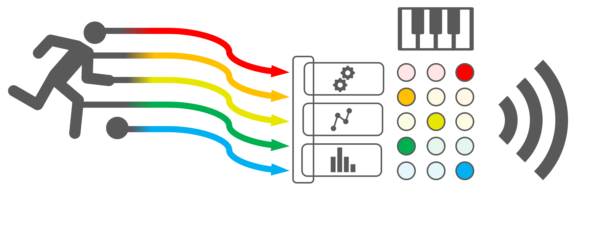

# Advanced Sonification Toolkit

A modular toolkit for real-time and recorded **movement-based sonification**, designed for flexible exploration of sensor data in contexts such as research, sports, rehabilitation, and interactive performance.

---

## Overview

The Advanced Sonification Toolkit provides a structured environment for mapping sensor data to sound.  
It supports both recorded datasets and live input streams, enabling users to experiment with and compare different sonification strategies without requiring low-level audio programming.

The system follows a modular architecture, allowing flexible configuration and extension.

---

## Requirements

This project requires a valid **Max** license to run.

Max Version: *Max 9.1.3*

Download Max:  
https://cycling74.com/downloads

---

## License

Licensed under the **PolyForm Noncommercial License 1.0.0**.  
Free for non-commercial use. Commercial use requires a separate agreement.

More information:  
https://polyformproject.org/licenses/noncommercial/1.0.0/

---

## Research Context

Developed within the **Digital Motion (DiMo / DiMo-NEXT)** research initiative, focusing on sensor-based movement analysis across disciplines such as sports, health, and human-centered design.

https://www.digital-motion.at

---

## Getting Started

Open the Max project here:

**AST_V2/AST_V2.maxproj**

Full documentation is available inside the project:

*AST_V2/Documentation.md*